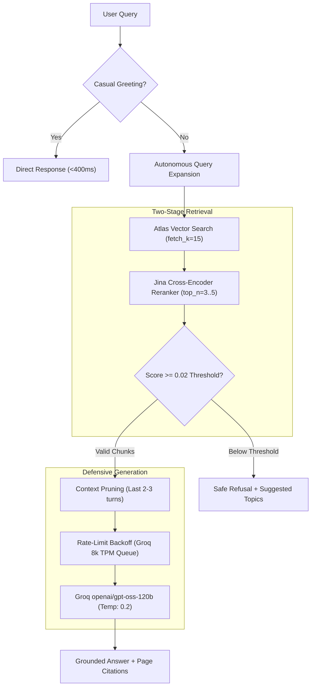

# Mandatory Common Challenge: Think Like a GenAI Engineer

This technical design document outlines production failure modes, root cause analyses, and resilient architecture patterns for enterprise document QA systems.

---

## 1. Production Failure Modes & Root Causes

| Failure Mode | Root Causes | Production Impact |
| :--- | :--- | :--- |
| **1. Confident Incorrect Answers (Hallucinations)** | - Model relies on internal parametric memory when context is sparse. - High temperature setting allowing creative token sampling. - Weak retrieval chunks returned without model refusal. | High: Erodes user trust and creates accuracy/compliance risks. |
| **2. Irrelevant Information Retrieval** | - Bi-encoder cosine distance matches broad topic similarity instead of exact answer. - Vocabulary mismatch between informal questions and formal prose. - Chunking splits relevant definitions across boundaries. | High: Pollutes prompt context and wastes tokens. |
| **3. Unexpected Output Formats** | - Long context windows causing instruction drift. - Missing structured schemas (JSON / Pydantic) or few-shot examples. | Moderate: Causes parser failures in frontend applications. |
| **4. External API Failures & Latency** | - Token rate limits (e.g. Groq 8k TPM limit on free tiers) hit by accumulating conversation history. - Network timeouts and unhandled HTTP 429/503 status codes. - Context stuffing (passing large chunk sets to the LLM). | High: Frozen UIs and dropped requests. |
| **5. Non-Deterministic Results** | - Temperature > 0.0 enabling stochastic sampling. - Arbitrary tie-breaking on tied vector similarity scores. - Unsorted candidate chunks passed to the prompt. | Moderate: Confusing user experience on repeated queries. |

---

## 2. Investigation & Observability Strategy

1. **Distributed Tracing (LangSmith):** Trace end-to-end turns (inputs, tool calls, rerank scores, token counts, and execution latency) to isolate whether delays come from retrieval or generation.
2. **Confidence Auditing:** Monitor cross-encoder score distributions. When top scores fall below $\tau = 0.05$, flag the query for synonym expansion or missing content.
3. **Citation Verification:** Enforce that every generated fact maps directly to a retrieved excerpt with exact file name and page citations.
4. **Golden Regression Benchmarks:** Maintain a suite of deterministic test questions to catch regressions across prompt or chunking updates.

---

## 3. Resilient Architecture Pipeline

### Key Engineering Safeguards:
- **Context Window Pruning:** Truncate multi-turn conversation history to the last 2-3 turns. In our testing on Groq, passing full history caused token counts to surge past 6,500, triggering 8k TPM pauses. Pruning keeps prompt sizes predictable (~2,000 tokens).
- **Exponential Backoff:** Wrap LLM requests in retry handlers capturing HTTP 413 and 429 status codes, pausing for the reset interval rather than failing the turn.
- **Calibrated Threshold Filtering:** Stage 2 cross-encoder scores are checked against a minimum threshold ($\tau = 0.02$). If all chunks fall below this floor, the system triggers a safe refusal.

---

## 4. Taxonomy of Solutions

| Problem Domain | Primary Layer | Implementation |
| :--- | :--- | :--- |
| **Hallucinations** | **Prompt + Retrieval** | Negative prompt constraints ("Base answers ONLY on excerpts"), mandatory inline citations, low temperature (0.2), active conversational refusal. |
| **Irrelevant Retrieval** | **Retrieval Pipeline** | Two-stage retrieval (Atlas vector search + Jina cross-encoder reranker), ReAct query expansion, 0.02 noise floor filtering. |
| **Format Errors** | **Application Logic** | Pydantic validation schemas, structured markdown instructions with few-shot format examples. |
| **API Latency & Limits** | **Application Logic** | Multi-turn context pruning (last 2-3 turns), compact top-3 reranked chunks, automatic retry backoff on 429/413. |
| **Non-Determinism** | **Model & Search Config**| Low temperature (0.2), deterministic candidate sorting by score, page, and chunk index. |

---

## 5. Engineering Trade-Offs

- **Two-Stage Retrieval vs. Latency:** Cross-encoder reranking adds ~200ms of latency, but filters out noisy candidate chunks that would otherwise inflate LLM context and trigger hallucinations. Net generation is cleaner and more precise.
- **Context Depth vs. Rate Limit Headroom:** Retaining full chat history maintains deep memory but exhausts token quotas (e.g. Groq 8k TPM). Pruning history to recent turns balances context retention with reliable uptime.
- **Strict Grounding vs. Creativity:** Forcing strict citation constraints means the system refuses out-of-scope questions instead of improvising. For document QA, factual accuracy and safe refusal take priority over creative speculation.
