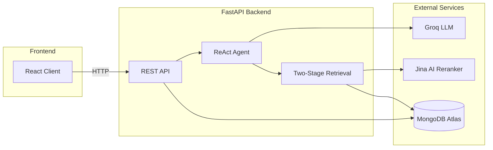

# QADoc

Agentic document question-answering system using a decoupled FastAPI backend, a LangGraph ReAct agent, and a React 19 single-page interface.

---

## Architecture



### How It Works

- **Ephemeral Ingestion:** Uploaded files (`.pdf`, `.docx`, `.txt`, `.md`) are parsed, split into chunks, embedded via Jina AI, indexed into MongoDB Atlas Vector Search, and immediately removed from local disk.
- **Two-Stage Retrieval:** Queries first retrieve candidate chunks from MongoDB Atlas Vector Search (Stage 1), which are then reranked by Jina AI Reranker v2 cross-encoder (Stage 2).
- **ReAct Reasoning:** The LangGraph ReAct agent running on Groq (`openai/gpt-oss-120b`) formulates search queries, reviews retrieved passages, and generates answers strictly grounded in the document text with source citations.

---

## Project Structure

```text
QADoc/
|-- backend/
|   |-- app/                 # FastAPI routes and schemas
|   |-- src/qadoc/           # Agent, retrieval tools, and MongoDB store
|   `-- pyproject.toml       # Dependencies (uv)
|-- frontend/
|   |-- src/                 # React components and styling
|   `-- package.json         # Dependencies (npm)
`-- README.md
```

---

## Quick Start

### 1. Backend

Requires Python 3.11+ and [uv](https://docs.astral.sh/uv/).

Create `backend/.env`:
```env
MONGODB_URI=mongodb+srv://<user>:<password>@cluster.mongodb.net/?retryWrites=true&w=majority
MONGODB_DB_NAME=docqa_chat
MONGODB_VECTOR_INDEX=doc_index
GROQ_API_KEY=gsk_...
GROQ_MODEL=openai/gpt-oss-120b
JINA_API_KEY=jina_...
```

Start the backend:
```bash
cd backend
uv run uvicorn app.main:app --reload --port 8000
```

API docs will be at `http://localhost:8000/docs`.

### 2. Frontend

Requires Node.js 18+.

```bash
cd frontend
npm install
npm run dev
```

Application will run at `http://localhost:5173`.

---

## License

MIT
