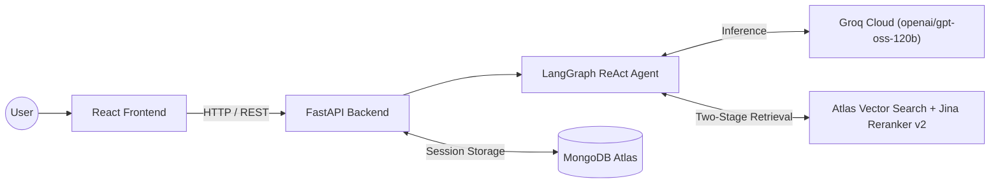
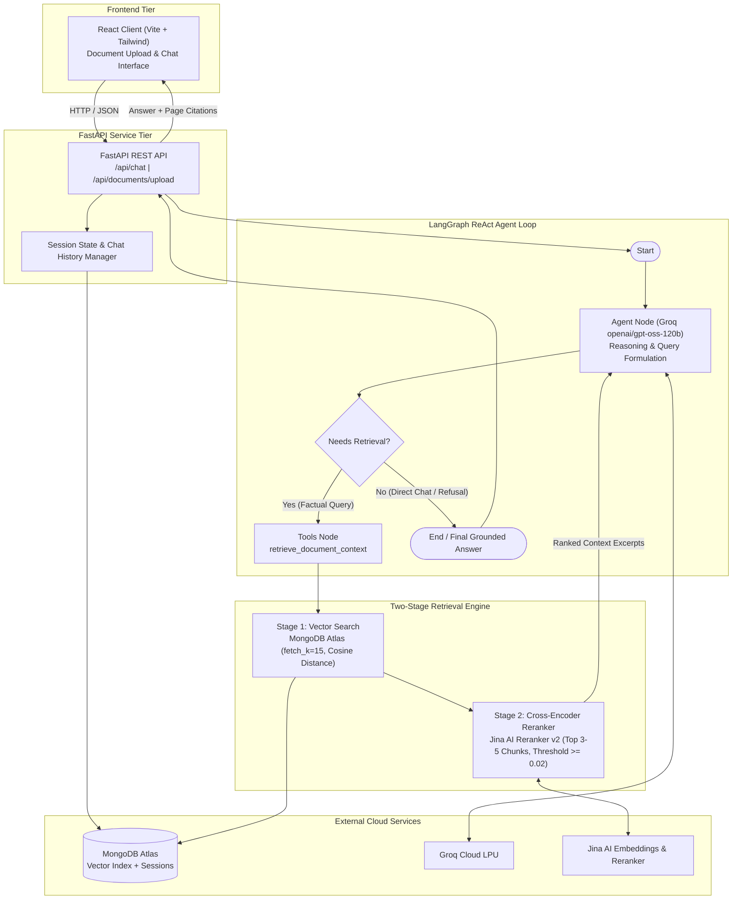

# QADoc

[](https://chatwithdocs-rc1m.onrender.com/)

Agentic document retrieval and question-answering system built with FastAPI, LangGraph ReAct agent, MongoDB Atlas Vector Search, Jina AI reranking, and a React frontend.

Live Demo: [https://chatwithdocs-rc1m.onrender.com/](https://chatwithdocs-rc1m.onrender.com/)

---

## Architecture

### System Overview



### Detailed Agent & Retrieval Pipeline



### How It Works

- **Ephemeral Ingestion:** Uploaded files (`.pdf`, `.docx`, `.txt`, `.md`) are parsed, split into 800-character chunks with 100-character overlap, embedded via Jina AI, indexed into MongoDB Atlas Vector Search, and immediately removed from local storage.
- **Two-Stage Retrieval:** Queries first retrieve 15 candidate chunks via MongoDB Atlas Vector Search (cosine similarity), followed by Jina AI Reranker v2 cross-encoder reranking to select the top 3-5 most relevant passages.
- **ReAct Agent Reasoning:** An autonomous LangGraph ReAct agent running on Groq (`openai/gpt-oss-120b`) formulates expanded search queries, analyzes retrieved passages, and produces answers strictly grounded in the document text with exact file and page citations.
- **Safe Refusal:** When user queries fall outside the document scope, the cross-encoder relevance scores drop below threshold ($\tau = 0.02$) and the agent safely refuses without hallucinating.

---

## Assessment Submission Documents

- **Evaluation Report:** [EVALUATION_REPORT.md](EVALUATION_REPORT.md) - Real benchmark results across `Gen AI Notes.pdf` and `MachineTranslationwithAttention.pdf` captured via LangSmith tracing, including latency, token usage, retrieval precision, and refusal verification.
- **Technical Decisions & Reasoning:** [TECHNICAL_DECISIONS.md](TECHNICAL_DECISIONS.md) - Rationale for the 3 core architectural choices and comprehensive answers to the 7 Problem Statement 1 reasoning challenges.
- **Common Challenge (Think Like a GenAI Engineer):** [COMMON_CHALLENGE.md](COMMON_CHALLENGE.md) - Production failure modes, root cause analyses, resilient pipeline design, and Groq TPM quota handling.
- **Sample Documents & Queries:** [sample_docs/](sample_docs/) - Sample technical PDFs and structured verification queries.

---

## AI Tool Disclosure

In compliance with assessment guidelines:
- **Tools Utilized:** Google Antigravity / Gemini AI Coding Assistant.
- **Scope of Assistance:**
  1. Assisted in structuring the two-stage retrieval pipeline, calibrating cross-encoder thresholds, and writing the LangGraph ReAct agent prompt.
  2. Assisted in compiling Markdown documentation, generating Mermaid flowcharts, and formatting evaluation tables from LangSmith trace outputs.
  3. Assisted in designing query expansion rules and conversational refusal prompts.
  All architecture designs, code implementations, and evaluation runs were tested, verified, and reviewed directly by the candidate.

---

## Local Setup Guide

### Prerequisites
- Python 3.11+
- [uv](https://docs.astral.sh/uv/) (fast Python package manager)
- Node.js 18+ and npm
- MongoDB Atlas cluster with Vector Search index configured
- Groq API Key and Jina AI API Key

---

### 1. Backend Setup

1. Navigate to the backend directory:
   ```bash
   cd backend
   ```

2. Create a `.env` file based on `.env.example`:
   ```env
   MONGODB_URI=mongodb+srv://<username>:<password>@cluster.mongodb.net/?retryWrites=true&w=majority
   MONGODB_DB_NAME=docqa_chat
   MONGODB_VECTOR_INDEX=doc_index
   GROQ_API_KEY=gsk_...
   GROQ_MODEL=openai/gpt-oss-120b
   JINA_API_KEY=jina_...
   ```

3. Install dependencies and start the backend:
   ```bash
   uv run uvicorn app.main:app --reload --port 8000
   ```

4. The API documentation will be available at `http://localhost:8000/docs`.

---

### 2. Frontend Setup

1. Navigate to the frontend directory:
   ```bash
   cd frontend
   ```

2. Install dependencies:
   ```bash
   npm install
   ```

3. Start the Vite development server:
   ```bash
   npm run dev
   ```

4. Open `http://localhost:5173` in your browser.

---

## License

MIT
