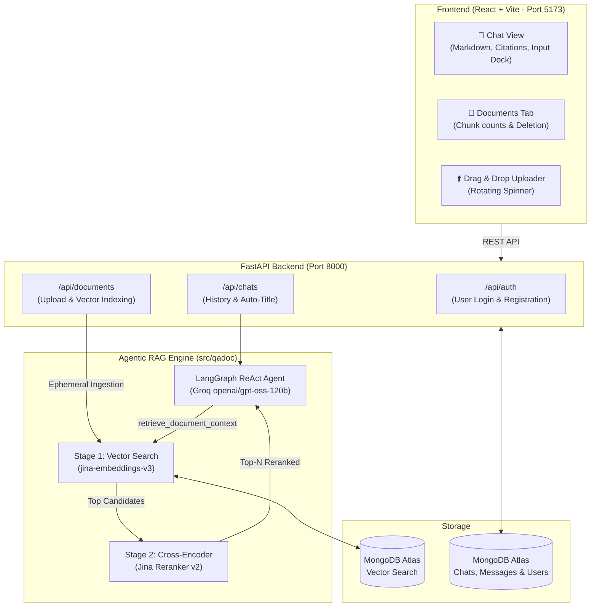

# QADoc — Intelligent Document QA Assistant

[](https://fastapi.tiangolo.com)
[](https://react.dev)
[](https://groq.com)
[](https://www.mongodb.com/products/platform/atlas-vector-search)
[](https://jina.ai)

**QADoc** is an enterprise-grade, agentic Document Question-Answering system. It combines a decoupled **FastAPI** backend running a **LangGraph ReAct Agent** with a **React + Vite** single-page application crafted with a light, distraction-free aesthetic inspired by Claude and ChatGPT.

---

## 🏛️ System Architecture



---

## 🌟 Key Highlights

* **ReAct Agent Reasoning:** Uses Groq Cloud's `openai/gpt-oss-120b` reasoning model to autonomously formulate search queries, incorporate previous conversation context (auto-rephrasing), and synthesize strictly grounded answers.
* **Two-Stage Retrieval:**
  * **Stage 1 (Atlas Vector Search):** Dense vector similarity matching using `jina-embeddings-v3` (1024 dimensions).
  * **Stage 2 (Jina AI Reranker v2):** Cross-encoder scoring (`jina-reranker-v2-base-multilingual`) to eliminate irrelevant chunks and order excerpts by precise semantic relevance.
* **Ephemeral Ingestion:** Files uploaded (`.pdf`, `.docx`, `.txt`, `.md`) are parsed, split, embedded into MongoDB Atlas, and **immediately deleted from disk** to ensure privacy and zero storage bloat.
* **Document Management Tab:** Each chat features a dedicated `Documents (N)` tab showing all ingested files, vector chunk counts, and one-click vector deletion.
* **Interactive Citations:** Assistant answers cite sources with clickable badges showing document name, page, and match score (e.g. `85% match`), opening full excerpt preview modals.
* **Strict Session Isolation:** Retrieval and document listings are strictly scoped per chat session — no document leaking across different chats.

---

## 📁 Repository Structure

```text
QADoc/
├── backend/
│   ├── app/
│   │   ├── main.py              <-- FastAPI application with CORS and lifespan
│   │   ├── schemas.py           <-- Pydantic request/response models
│   │   └── routers/
│   │       ├── auth.py          <-- /api/auth (Login, Register)
│   │       ├── chats.py         <-- /api/chats (Conversations, QA, Auto-title)
│   │       └── documents.py     <-- /api/documents (Upload, List, Delete)
│   ├── src/qadoc/
│   │   ├── config.py            <-- Central Pydantic settings
│   │   ├── database/            <-- MongoDB connection & session persistence
│   │   └── rag/                 <-- ReAct agent, tools, prompts, & two-stage retrieval
│   ├── pyproject.toml           <-- Backend dependencies
│   ├── uv.lock
│   └── README.md                <-- Backend documentation
│
├── frontend/
│   ├── src/
│   │   ├── App.jsx              <-- Main React application & tab state
│   │   ├── index.css            <-- Claude / ChatGPT light theme styling & animations
│   │   ├── api/client.js        <-- Fetch API client
│   │   └── components/
│   │       ├── Sidebar.jsx      <-- QADoc branding, chat list, & user badge
│   │       ├── ChatDocumentsTab.jsx <-- Ingested files view & deletion
│   │       ├── Citations.jsx    <-- Interactive citation pills & modal
│   │       ├── FileUploadModal.jsx <-- Ingestion modal with rotating spinner
│   │       └── AuthScreen.jsx   <-- User login / registration view
│   ├── vite.config.js           <-- Vite dev server with proxy to :8000
│   ├── package.json
│   └── README.md                <-- Frontend documentation
│
└── README.md                    <-- Project overview
```

---

## 🚀 Quick Start Guide

### 1. Prerequisites
- **Python 3.11+** with [`uv`](https://docs.astral.sh/uv/) installed.
- **Node.js 18+** with `npm`.
- A **MongoDB Atlas** cluster with an Atlas Vector Search index named `doc_index`.
- API keys for **Groq Cloud** and **Jina AI**.

---

### 2. Configure Backend Environment
Create `backend/.env`:
```env
MONGODB_URI=mongodb+srv://<username>:<password>@cluster.mongodb.net/?retryWrites=true&w=majority
MONGODB_DB_NAME=docqa_chat
MONGODB_VECTOR_INDEX=doc_index

GROQ_API_KEY=gsk_...
GROQ_MODEL=openai/gpt-oss-120b

JINA_API_KEY=jina_...
```

---

### 3. Start the Backend Server
```bash
cd backend
uv run uvicorn app.main:app --reload --port 8000
```
*API docs:* `http://localhost:8000/docs`

---

### 4. Start the Frontend
In a new terminal window:
```bash
cd frontend
npm install
npm run dev
```
*Web application:* `http://localhost:5173`

---

## 📄 License
This project is licensed under the MIT License.
