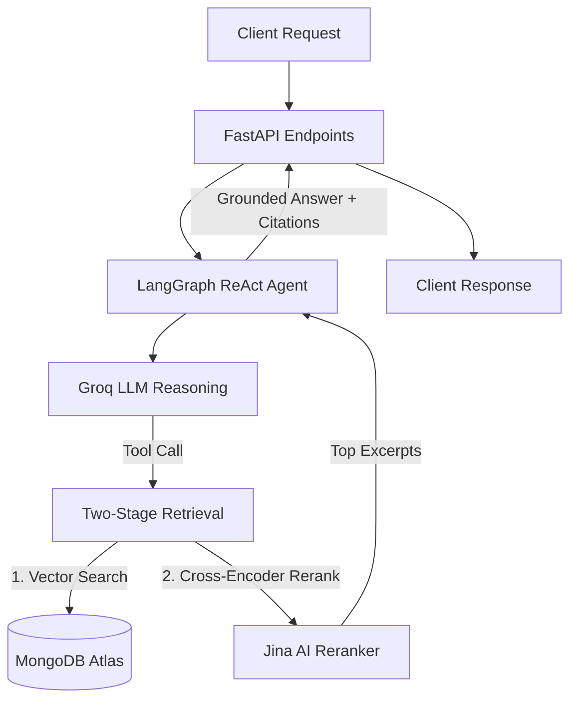

# QADoc Backend

FastAPI backend with a LangGraph ReAct agent, two-stage vector retrieval, and MongoDB Atlas persistence.

---

## Architecture



---

## Retrieval Pipeline

1. **Upload & Ingestion:** Files (`.pdf`, `.docx`, `.txt`, `.md`) uploaded through `/api/documents/upload/{chat_id}` are chunked, embedded via `jina-embeddings-v3` (1024-dim), stored in Atlas Vector Search with `chat_id` metadata, and deleted from disk.
2. **Stage 1 (Vector Search):** Initial cosine similarity search queries Atlas Vector Search for the top candidate chunks matching the expanded query.
3. **Stage 2 (Cross-Encoder):** Candidate chunks are scored by `jina-reranker-v2-base-multilingual`. Chunks meeting the relevance threshold are sorted and returned to the agent.
4. **Agent Synthesis:** The ReAct agent synthesizes a grounded answer citing source documents, page numbers, and relevance scores.

---

## API Summary

- **Auth (`/api/auth`):**
  - `POST /api/auth/register` - Create account
  - `POST /api/auth/login` - Authenticate user
- **Chats (`/api/chats`):**
  - `GET /api/chats?user_id={id}` - List user chats
  - `POST /api/chats?user_id={id}` - Create new chat
  - `GET /api/chats/{chat_id}/messages` - Chat message history
  - `POST /api/chats/{chat_id}/ask?user_id={id}` - Submit question to ReAct agent
  - `DELETE /api/chats/{chat_id}?user_id={id}` - Delete chat session
- **Documents (`/api/documents`):**
  - `POST /api/documents/upload/{chat_id}?user_id={id}` - Ingest files into vector store
  - `GET /api/documents/{chat_id}?user_id={id}` - List files and chunk counts for chat
  - `DELETE /api/documents/{chat_id}/{filename}?user_id={id}` - Delete file chunks from vector store

---

## Environment Configuration

Create `backend/.env`:
```env
MONGODB_URI=mongodb+srv://<user>:<password>@cluster.mongodb.net/?retryWrites=true&w=majority
MONGODB_DB_NAME=docqa_chat
MONGODB_VECTOR_INDEX=doc_index
GROQ_API_KEY=gsk_...
GROQ_MODEL=openai/gpt-oss-120b
JINA_API_KEY=jina_...
```

---

## Running Locally

```bash
cd backend
uv run uvicorn app.main:app --reload --port 8000
```

Swagger API documentation: `http://localhost:8000/docs`.
