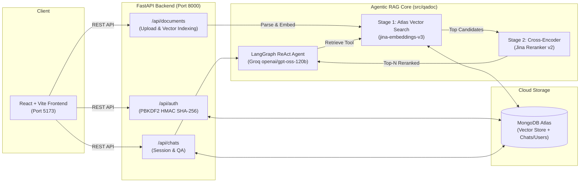

# QADoc — FastAPI Backend & ReAct RAG Engine

High-performance REST API and Agentic RAG core for **QADoc**, powered by **FastAPI**, **LangGraph ReAct Agent**, **MongoDB Atlas Vector Search**, and **Jina AI Reranker v2**.

---

## 🏗️ Architecture & Technology Stack



### Key Technologies
- **API Framework:** FastAPI 0.115+ (asynchronous REST endpoints, Pydantic v2 schemas).
- **LLM Reasoning:** Groq Cloud running `openai/gpt-oss-120b` ReAct agent with tool calling.
- **Embeddings:** Jina AI `jina-embeddings-v3` (1024-dimensional dense vectors).
- **Vector Search:** MongoDB Atlas Vector Search (cosine similarity search with pre-filtering).
- **Cross-Encoder Reranker:** Jina AI Reranker v2 (`jina-reranker-v2-base-multilingual`).
- **Observability:** LangSmith end-to-end distributed tracing.

---

## ⚡ Ephemeral File Ingestion

Uploaded documents (`.pdf`, `.docx`, `.txt`, `.md`) are:
1. Written temporarily to memory/disk.
2. Parsed and split into character chunks with overlap.
3. Embedded via Jina AI and saved into MongoDB Atlas Vector Search.
4. **Immediately deleted from disk** after successful ingestion to avoid lingering storage overhead.

---

## 🔌 API Endpoints

### 1. Authentication (`/api/auth`)
* `POST /api/auth/register`: Register new user account.
* `POST /api/auth/login`: Authenticate and return user info.

### 2. Chat Sessions (`/api/chats`)
* `GET /api/chats?user_id={id}`: List all chats for a user.
* `POST /api/chats?user_id={id}`: Create a new chat session.
* `GET /api/chats/{chat_id}/messages`: Fetch chronological message history.
* `POST /api/chats/{chat_id}/ask?user_id={id}`: Ask the ReAct agent; returns grounded answer, citations, and auto-generated topic title.
* `DELETE /api/chats/{chat_id}?user_id={id}`: Delete a chat and all its associated messages.

### 3. Document Management (`/api/documents`)
* `POST /api/documents/upload/{chat_id}?user_id={id}`: Upload files and index into Atlas.
* `GET /api/documents/{chat_id}?user_id={id}`: List all ingested documents and chunk counts for this chat.
* `DELETE /api/documents/{chat_id}/{filename}?user_id={id}`: Delete document embeddings from Atlas for this chat.

---

## 🚀 Setup & Execution

### Prerequisites
* Python 3.11+
* [`uv`](https://docs.astral.sh/uv/) package manager (recommended) or standard `pip`

### 1. Configure Environment Variables
Create `.env` in `backend/`:
```env
MONGODB_URI=mongodb+srv://<username>:<password>@cluster.mongodb.net/?retryWrites=true&w=majority
MONGODB_DB_NAME=docqa_chat
MONGODB_VECTOR_INDEX=doc_index
GROQ_API_KEY=gsk_...
GROQ_MODEL=openai/gpt-oss-120b
JINA_API_KEY=jina_...
```

### 2. Install Dependencies & Start Server
```bash
cd backend
uv run uvicorn app.main:app --reload --port 8000
```

Interactive OpenAPI Swagger documentation will be available at `http://localhost:8000/docs`.
