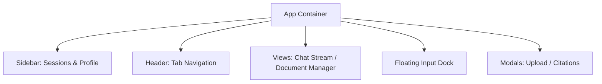

# QADoc Frontend

React 19 single-page application built with Vite, styled with a minimalist light aesthetic.

---

## Component Layout



---

## Features

- **Chat Interface:** Conversation history rendered with `react-markdown`, interactive citation badges, and auto-scrolling message stream.
- **Interactive Citations:** Clickable source badges showing file name, page, and match score that open full-text excerpt modals.
- **Document Management:** Dedicated tab showing ingested files, vector chunk counts, and file-level chunk deletion.
- **Floating Input Dock:** Auto-resizing textarea with file drag-and-drop ingestion and keyboard shortcuts (`Enter` to send, `Shift+Enter` for newline).
- **Session Management:** Multi-chat sidebar with automatic title generation from the conversation topic.

---

## Running Locally

### 1. Install Dependencies
```bash
cd frontend
npm install
```

### 2. Start Development Server
```bash
npm run dev
```

The application runs at `http://localhost:5173`. API requests to `/api` are automatically proxied to the backend at `http://localhost:8000`.

### 3. Production Build
```bash
npm run build
```
Outputs optimized static assets to `dist/`.
